# Automated Release Management Pipeline with Semantic Versioning and Git Tags

A complete DevOps delivery pipeline in which **nobody chooses version numbers by hand**. Every commit follows [Conventional Commits](https://www.conventionalcommits.org). When changes reach `main`, the pipeline:

1. works out the next [semantic version](https://semver.org),
2. writes the changelog,
3. creates the Git tag and the GitHub Release,
4. publishes a versioned Docker image,
5. deploys that exact image to staging and then production,
6. and checks that the deployed app reports the new version.

| Commit message | Example | Release |
|---|---|---|
| `fix: …` / `perf: …` | `fix(api): reject malformed versions` | **PATCH** 1.4.2 → 1.4.3 |
| `feat: …` | `feat(ui): add release timeline` | **MINOR** 1.4.2 → 1.5.0 |
| `feat!: …` or a `BREAKING CHANGE:` footer | `feat(api)!: rename endpoint` | **MAJOR** 1.4.2 → 2.0.0 |
| `docs:` `test:` `ci:` `chore:` `refactor:` `style:` `build:` | `docs: update README` | no release |

The application being delivered is a **release dashboard and semantic-version API**. It shows which version is deployed and the full release history. It also has a calculator that predicts the next version from commit messages, using the same rules as the pipeline.

---

## Architecture

```mermaid
flowchart LR
    dev([Developer]) -->|"git commit (commitlint hook)"| pr[Pull request]
    pr --> ci{{"CI quality gate<br/>commitlint · ESLint · Vitest + coverage<br/>npm audit · build · Docker smoke test<br/>release preview"}}
    ci -->|merge| main[(main branch)]
    main --> gate{{Quality gate<br/>re-run on main}}
    gate --> sr["semantic-release<br/>analyse commits → next version<br/>CHANGELOG.md · package.json<br/>Git tag vX.Y.Z · GitHub Release + assets"]
    sr -->|new version?| img["Docker Buildx<br/>linux/amd64 + arm64<br/>SBOM + provenance"]
    img --> ghcr[("GHCR<br/>:X.Y.Z :X.Y :X :latest")]
    ghcr --> stg["Staging<br/>docker compose up --wait<br/>smoke test vs. version"]
    stg --> prod["Production<br/>(optional approval)<br/>Render + GitHub Pages<br/>smoke test vs. version"]
```



| Workflow | Trigger | Purpose |
|---|---|---|
| [`ci.yml`](.github/workflows/ci.yml) | Pull requests; reused by `release.yml` | Commit and PR-title lint, ESLint, tests on Node 22 and 24 with coverage thresholds, dependency audit, build artifact, Docker build plus container smoke test, release preview |
| [`release.yml`](.github/workflows/release.yml) | Push to `main` (stable) or `beta` (pre-release) | Quality gate → semantic-release → multi-arch image to GHCR → staging → production |
| [`deploy.yml`](.github/workflows/deploy.yml) | Called by `release.yml`; run manually for **rollback** | Promotes an existing released image to an environment and verifies it |

## Repository layout

```
├── src/
│   ├── core/            # Semver engine shared by server and browser (no Node imports)
│   │   ├── semver.js    #   parse / compare / bump (SemVer 2.0.0)
│   │   ├── commits.js   #   Conventional Commit analysis → next version
│   │   └── changelog.js #   CHANGELOG.md → structured release history
│   ├── server/          # Express app: /health, /api/version, /api/releases, /api/semver/*
│   └── index.js         # Process entrypoint (logging, graceful SIGTERM shutdown)
├── public/              # Dashboard frontend (HTML/CSS/JS modules)
├── scripts/
│   ├── build.js           # Application build → dist/ (+ build-info.json, releases.json)
│   ├── smoke-test.js      # Post-deployment verification (health + expected version)
│   ├── next-version.js    # Release preview from commits since the last tag
│   └── package-release.js # Versioned .tar.gz + SHA256SUMS for the GitHub Release
├── tests/               # Vitest unit + API integration tests (supertest)
├── Dockerfile           # 3-stage build, non-root, read-only friendly, HEALTHCHECK
├── docker-compose.yml   # Deployment manifest (local + staging)
├── .releaserc.json      # semantic-release configuration
├── commitlint.config.js # Commit message rules
├── .husky/              # Git hooks: commit-msg (commitlint), pre-commit (lint + test)
├── .github/             # Workflows, Dependabot, PR template
└── docs/                # Setup guide, project report, demo guide
```

## Running locally

Requires Node.js 22.22+ (24 LTS recommended). Docker is optional.

```bash
npm install            # also installs the Git hooks
npm test               # unit + API tests
npm run test:coverage  # with coverage thresholds (90% lines)
npm run lint
npm run dev            # build + start on http://localhost:3000 with auto-reload
```

With Docker:

```bash
docker compose up --build          # http://localhost:3000
docker run -p 3000:3000 ghcr.io/<owner>/<repo>:latest   # any released version
```

### Useful scripts

| Command | What it does |
|---|---|
| `npm run build` | Builds `dist/` and stamps the version, commit and date into it |
| `npm run release:preview` | Shows which version the commits since the last tag would release |
| `npm run release:dry-run` | Runs semantic-release in dry-run mode (needs `GITHUB_TOKEN=$(gh auth token)`) |
| `npm run smoke -- <url> --expect-version 1.2.3` | Runs the post-deployment checks against any deployment |

## API

| Method & path | Description |
|---|---|
| `GET /health` | Liveness probe: `{ "status": "ok", "version": "1.4.2" }` |
| `GET /api/version` | Version, commit, build date, environment, Node version, uptime |
| `GET /api/releases` · `GET /api/releases/:version` | Release history parsed from the changelog |
| `POST /api/semver/next` | `{ "current": "1.4.2", "commits": ["feat: x", "fix: y"] }` → `{ "next": "1.5.0", "releaseType": "minor", … }` |
| `GET /api/semver/bump?version=1.4.2&type=minor` | → `1.5.0` (`type`: major, minor, patch, prerelease; optional `preid`) |
| `GET /api/semver/compare?a=1.10.0&b=1.9.0` | SemVer precedence: `{ "result": 1, "relation": "higher" }` |

## Versioning in detail

- **Single source of truth: Git tags.** semantic-release finds the latest `vX.Y.Z` tag on the branch and looks at every commit since it. The highest-impact commit decides the bump (major > minor > patch). If no commit is releasable, nothing is released.
- **Release commit.** `package.json`, `package-lock.json` and `CHANGELOG.md` are updated in a `chore(release): X.Y.Z [skip ci]` commit, and that commit is tagged. `[skip ci]` stops it from starting the pipeline again.
- **Version stamped into every artifact.** The same version appears in the image tags, the OCI labels, `/api/version`, the dashboard, the GitHub Release and the release tarball.
- **Image tags.** `1.4.2` never changes once published. `1.4` and `1` move to the newest matching release, and `latest` is the newest stable release.
- **Pre-releases.** Commits pushed to the `beta` branch produce `2.0.0-beta.1`, `2.0.0-beta.2` and so on. These are tagged in GHCR as `beta`, deployed to staging only, and marked as pre-releases on GitHub.
- **Rollback.** Go to *Actions → Deploy → Run workflow* and enter an earlier version. Its already-tested image is redeployed without a rebuild.
- **Release preview.** Every PR runs the app's own engine against the commits since the last tag and shows the version that merging will produce. It matches semantic-release's result in the patch, minor, major and no-release cases.

## Documentation

- [docs/SETUP.md](docs/SETUP.md): one-time GitHub, GHCR, Pages and Render configuration
- [docs/DEMO_GUIDE.md](docs/DEMO_GUIDE.md): step-by-step script for demonstrating the pipeline
- [docs/PROJECT_REPORT.md](docs/PROJECT_REPORT.md): project report for submission
- [CHANGELOG.md](CHANGELOG.md): generated release notes
