# Automated Release Management Pipeline with Semantic Versioning and Git Tags

**DevOps Mini Project: LAB CA, Activity 2**

| | |
|---|---|
| Institute | K. J. Somaiya College of Engineering, Somaiya Vidyavihar University |
| Department | Computer Engineering |
| Course | DevOps (216U01E744), Semester VII, L.Y. B.Tech, 2026–27 |
| Group members | Aditey Kshirsagar (16010123017) · Aditya Baheti (16010123023) |
| Faculty in-charge | Dr. Nirmala Baloorkar |
| Repository | https://github.com/Aditey1908/semver-release-pipeline |
| Live deployment | https://devopslabca.onrender.com |

---

## Abstract

Releasing software by hand is slow and error-prone. Versions are bumped inconsistently, changelogs go stale, and it is often unclear which build is running in which environment. This project automates the whole release process. Developers write commit messages in the Conventional Commits format. A GitHub Actions pipeline validates every change, then works out the next Semantic Version from the commit history. It records the release as a Git tag, generates the changelog and GitHub Release, and publishes a versioned, multi-architecture Docker image to the GitHub Container Registry. It then promotes that same image through staging and production, checking each deployment against the expected version. Rollback is a redeployment of any earlier version tag. The delivered application is a release dashboard and semantic-version REST API, which also exposes the versioning rules to users.

## 1. Introduction

### 1.1 Problem statement

In many teams, releasing means editing a version number, writing release notes, tagging and building by hand. Each manual step can go wrong:

- a breaking change shipped as a patch version breaks users who trusted the version number;
- a missed tag makes it impossible to tell which commit is running in production;
- a changelog written from memory leaves changes out;
- an image rebuilt between test and deployment means production is not running what was tested.

### 1.2 Objectives

1. Enforce a commit convention that captures the *intent* of each change (fix, feature, breaking change).
2. Calculate the next version automatically according to Semantic Versioning 2.0.0.
3. Use Git tags as the single source of truth for releases.
4. Generate changelogs, GitHub Releases and release assets with no manual editing.
5. Gate every release behind automated quality checks: lint, tests, coverage, dependency audit, and a container build with a smoke test.
6. Containerise the application and publish immutable, versioned images.
7. Deploy through staging to production, verify each deployment, and support one-click rollback.

### 1.3 Scope

The project covers every stage named in the evaluation scheme: version control, build, automated testing, containerisation, CI/CD, deployment and documentation. It uses only free services: GitHub, GitHub Actions, GHCR and Render's free tier.

## 2. Background

**Semantic Versioning (SemVer 2.0.0).** A version `MAJOR.MINOR.PATCH` tells users what to expect. A PATCH contains backwards-compatible bug fixes. A MINOR adds backwards-compatible functionality. A MAJOR contains incompatible changes. Pre-release versions such as `2.0.0-beta.1` have lower precedence than the release they lead up to.

**Conventional Commits.** A lightweight convention for commit messages: `type(scope)!: subject`, with an optional body and footers. The type and the optional `!` or `BREAKING CHANGE:` footer can be read by machines, so the release impact of a commit can be calculated:

| Commit | Release |
|---|---|
| `fix:`, `perf:`, a git revert | PATCH |
| `feat:` | MINOR |
| `type!:` or a `BREAKING CHANGE:` footer | MAJOR |
| `docs:`, `test:`, `ci:`, `chore:`, `refactor:`, `style:`, `build:` | none |

**Git tags** are named references to specific commits. Tagging each release `vX.Y.Z` permanently links a version to the exact source it was built from, and makes it easy to compare two releases (`git diff v1.1.0 v1.2.0`).

## 3. Tools and technologies

| Area | Tool | Use in this project |
|---|---|---|
| Version control | Git, GitHub | Source history, pull requests, tags, releases |
| Commit convention | commitlint, Husky | Rejects non-conforming commits locally (Git hook) and in CI |
| Application | Node.js 24 LTS, Express 5, Helmet | Semantic-version REST API and static file server |
| Frontend | React 19, Tailwind CSS 4, neobrutalism.dev components | Release dashboard UI |
| Build | Vite 8, Node build script | Bundles the dashboard into `dist/` and stamps version metadata into it |
| Testing | Vitest, Supertest, V8 coverage | Unit and API integration tests, coverage thresholds, JUnit report |
| Code quality | ESLint 10, npm audit | Static analysis, dependency vulnerability gate |
| Release automation | semantic-release | Version calculation, CHANGELOG, Git tag, GitHub Release |
| Containerisation | Docker, Buildx, Docker Compose | Multi-stage image, multi-arch build, deployment manifest |
| Registry | GitHub Container Registry (GHCR) | Versioned image storage with SBOM and provenance |
| CI/CD | GitHub Actions | CI, release, deployment and rollback workflows |
| Hosting | Render; GitHub Pages (optional) | Production container; an optional static copy of the dashboard |
| Maintenance | Dependabot | Automated dependency updates with conventional prefixes |

## 4. System architecture

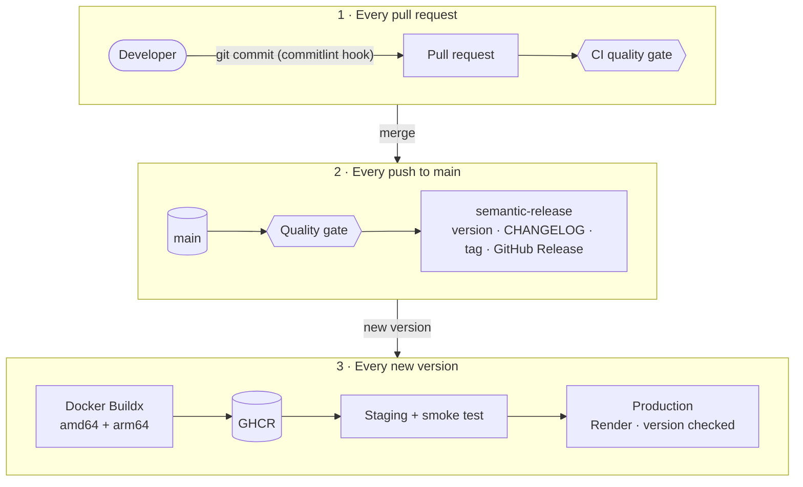

_Figure 1: Pipeline overview_

The pipeline consists of three GitHub Actions workflows:

| Workflow | Trigger | Stages |
|---|---|---|
| `ci.yml` | Every pull request; called by `release.yml` | Commit and PR-title lint · ESLint · tests on Node 22 and 24 with coverage · dependency audit · build artifact · Docker build and container smoke test · release preview |
| `release.yml` | Push to `main` (stable) or `beta` (pre-release) | Quality gate → semantic release → image publish → staging → production |
| `deploy.yml` | Called by `release.yml`; manual for rollback | Validate version → confirm image → deploy → smoke test → publish Pages (optional) |

`ci.yml` is a *reusable workflow*. The checks that guard pull requests run again, unchanged, as the first stage of every release, so the same definition is never duplicated. `deploy.yml` is reusable in the same way, so a normal release and a rollback follow the same, already-tested deployment path.

## 5. Implementation

### 5.1 Version control and branching

- **Trunk-based development.** Everything lands on `main`, and every push to `main` is a release candidate. Feature and dependency changes went through pull requests, where CI checks them first (#6 and #7); small documentation changes were pushed directly. Either way, the full quality gate runs again on `main` before anything is released. A `beta` branch is configured for pre-releases (`X.Y.Z-beta.N`) but has not been needed yet.
- **Commit convention enforced twice.** Husky installs a `commit-msg` hook that runs commitlint, and a `pre-commit` hook that runs lint and tests. Hooks can be skipped locally, so CI checks every commit in the PR, and the PR title, again.
- **Dependabot** opens update PRs with `fix(deps):` for production dependencies, which produces a patch release, and `chore(deps):` for development tooling, which produces no release.

### 5.2 Application

The application under delivery is a Node.js/Express service:

- `src/core/` is a dependency-free semantic-versioning engine. It parses, compares and bumps versions according to SemVer 2.0.0, analyses Conventional Commits, and parses the generated changelog. Because it has no Node-specific imports (enforced by an ESLint rule), the same code runs on the server and in the browser.
- `src/server/` contains the REST API: `/health`, `/api/version`, `/api/releases` (and `/api/releases/:version`), `/api/semver/next`, `/api/semver/bump`, `/api/semver/parse` and `/api/semver/compare`. It validates input, applies security headers with Helmet, and returns errors as JSON without exposing internals.
- `web/` is a React dashboard showing the deployed version, commit, build time and environment, the release history, and an interactive next-version calculator. It is styled with Tailwind CSS and the open-source [neobrutalism.dev](https://www.neobrutalism.dev) component library (Card, Button, Badge, Input, Textarea, Table and Marquee). The components are copied into the project from the library's registry, as the library intends, and use its "Blue" theme. The calculator imports the same `src/core` engine as the server, so the browser and the API cannot disagree.
- `src/index.js` writes structured JSON logs and shuts down gracefully on `SIGTERM`, which matters for containers.

### 5.3 Build

`npm run build` uses Vite to bundle the React dashboard into `dist/`, a self-contained static site with minified, content-hashed assets and self-hosted fonts. The container serves it, the same build can be published to GitHub Pages, and asset URLs are relative so the same build works at any URL path. The build also writes:

- `build-info.json`, containing the version, commit SHA, build time and repository URL. These come from the pipeline (`APP_VERSION`, `GIT_SHA`, …), with local fallbacks.
- `releases.json`, the release history parsed from `CHANGELOG.md`.

The build fails if the version is not valid SemVer. This is how the release version reaches the running application: `/api/version` and the dashboard read the values stamped in at build time.

### 5.4 Automated testing

95 automated tests run with Vitest:

| Suite | Covers |
|---|---|
| `tests/unit/semver.test.js` | Parsing (including invalid inputs), the precedence ordering example from the SemVer specification, bumping, pre-releases |
| `tests/unit/commits.test.js` | Commit parsing, `!` and `BREAKING CHANGE` detection, reverts, highest-impact selection, first release = 1.0.0 |
| `tests/unit/changelog.test.js` | Parsing of a **real** CHANGELOG produced by semantic-release |
| `tests/integration/api.test.js` | Every endpoint via Supertest, input validation, malformed JSON, 404/500 handling, security headers |
| `tests/unit/dashboard.test.js` | Dashboard helpers: release-type classification, development-build detection, date formatting, data loading and its fallback when no API exists |

Coverage thresholds of 90% lines, statements and functions and 85% branches are enforced, so CI fails if coverage drops. The achieved coverage is about 99% of lines. In CI the tests run on Node 22 and Node 24, and a JUnit report and an HTML coverage report are uploaded as artifacts.

After each deployment, `scripts/smoke-test.js` checks the live service. It verifies that `/health` is OK and that `/api/version` reports the *expected* version, retrying while the deployment rolls out. It also checks that the dashboard is served and that the API computes a correct result.

### 5.5 Containerisation

The `Dockerfile` has three stages:

1. **deps**: `npm ci --omit=dev`, so the image contains production dependencies only.
2. **build**: installs the build tooling and runs the Vite build, with the version metadata passed as build arguments. It runs on the build machine's native platform (`--platform=$BUILDPLATFORM`) because its output is plain static files, so multi-architecture builds don't have to emulate the slowest stage.
3. **runtime**: `node:24-alpine` with only `package.json`, `src/`, `dist/` and the production `node_modules`.

Hardening measures:

- The app runs as a non-root user (UID 1000).
- The application files are owned by root, so the process cannot modify them.
- The container works with a read-only root filesystem.
- `no-new-privileges` is set.
- A `HEALTHCHECK` probes `/health`.
- OCI labels record the version, revision and creation time.
- `.dockerignore` keeps tests, docs, `.git` and secrets out of the build context.

`docker-compose.yml` is the deployment manifest for local runs and for staging.

### 5.6 Continuous integration

Every pull request runs `ci.yml`. Its jobs run in parallel where possible:

1. **Conventional commits**: commitlint over the PR's commit range and the PR title.
2. **Lint & test**: a matrix over Node 22 and 24, with coverage thresholds.
3. **Dependency audit**: fails on high-severity vulnerabilities in production dependencies.
4. **Build application**: uploads `dist/` as an artifact.
5. **Docker build & container smoke test**: builds the image with layer caching, runs it with production hardening flags, smoke-tests it, and checks that Docker reports it as `healthy`.
6. **Release preview**: predicts the version the PR will release and posts it in the job summary.

### 5.7 Release automation with semantic versioning and Git tags

On every push to `main`, `release.yml` first re-runs the full quality gate. semantic-release (configured in `.releaserc.json`) then performs the release through its plugins:

| Plugin | Step |
|---|---|
| `commit-analyzer` | Finds the last `v*` tag, reads the commits since it, and decides patch, minor, major or no release |
| `release-notes-generator` | Groups commits into Features, Bug Fixes, BREAKING CHANGES and so on |
| `changelog` | Prepends the notes to `CHANGELOG.md` |
| `npm` | Writes the new version into `package.json` (publishing to npm is disabled) |
| `exec` | Builds `dist/` and packages it as `…-vX.Y.Z.tar.gz` with a `SHA256SUMS.txt` |
| `git` | Commits the changed files as `chore(release): X.Y.Z [skip ci]` and pushes |
| `github` | Creates the `vX.Y.Z` tag and GitHub Release, uploads the assets, and comments on the released issues and PRs |

The workflow compares the repository's tags before and after this step to detect whether a new version was published, and passes `version`, `tag`, `prerelease` and `channel` as job outputs to the later stages. If nothing is releasable, the run ends with a "No release" summary.

**Image publication.** The image job checks out the new tag rather than the triggering commit, so the build includes the bumped version and changelog. It builds for `linux/amd64` and `linux/arm64` and pushes to GHCR with these tags:

- `X.Y.Z` (never changed once published)
- `X.Y` and `X` (move to the newest matching release)
- `latest` (newest stable release)

Pre-releases are tagged only with their full version and the channel name (`beta`). Each image carries an SBOM and build-provenance attestations.

### 5.8 Deployment

Deployment *promotes* the image that was already built. Nothing is rebuilt between environments.

- **Staging**: an ephemeral environment on the runner. The released image is pulled from GHCR and started with `docker compose up --wait`, which waits for the health check. The smoke test then verifies the version, the logs are collected, and the environment is torn down.
- **Production**: the GitHub `production` environment can require a reviewer's approval, which gives a manual release gate. The job calls Render's deploy hook with `imgURL=ghcr.io/…:X.Y.Z`. It then polls the public URL until it reports the new version. When Pages is enabled, it also publishes the dashboard for that version there; it is switched off for this private repository.
- **Pre-releases** from `beta` stop at staging.

Concurrency groups ensure two releases never run at once and that a release is never cancelled midway.

### 5.9 Rollback

Every released image stays in GHCR under its version tag, so rolling back is an ordinary deployment. Run **Actions → Deploy → Run workflow** with an older version, and the same validated deployment path redeploys that image and verifies it.

### 5.10 Security practices

- Workflow `GITHUB_TOKEN` permissions are least-privilege and set per job.
- User-controlled values such as PR titles and inputs are passed through environment variables and never interpolated into scripts.
- The release job runs `npm audit signatures` to verify the integrity of installed packages.
- The image is non-root and read-only, and carries an SBOM and provenance.
- Helmet sets security headers, request bodies are size-limited, the dashboard is protected from XSS, and internal error details are hidden.
- Secrets (the Render deploy hook) are scoped to the `production` environment.

## 6. Results

All figures come from real runs of this project's pipeline between 6 and 22 October 2026. The repository is private, so the pipeline evidence is shown as GitHub CLI output and GitHub Actions log excerpts rather than screenshots of GitHub's web pages. Excerpts are filtered with `grep`, and timestamps, long URLs and image digests are shortened for readability; nothing else is changed.

### 6.1 Version control

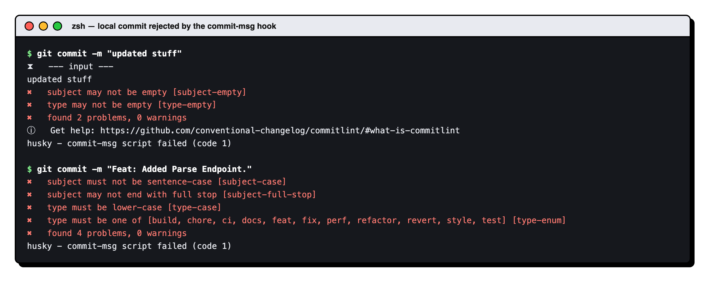

*Figure 2: The `commit-msg` Git hook runs commitlint and rejects messages that don't follow Conventional Commits, before the commit is created.*

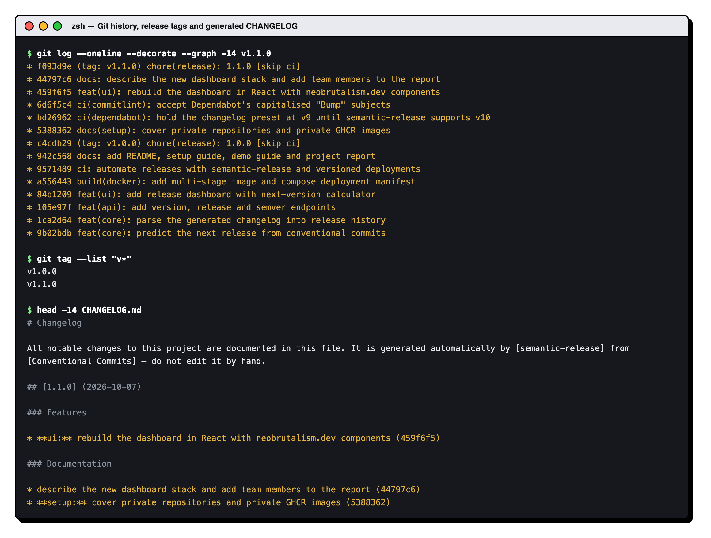

*Figure 3: The history up to the v1.1.0 release. Every commit follows Conventional Commits, each release is a `chore(release)` commit tagged `vX.Y.Z`, and `CHANGELOG.md` is generated from the commit messages.*

### 6.2 Automated testing

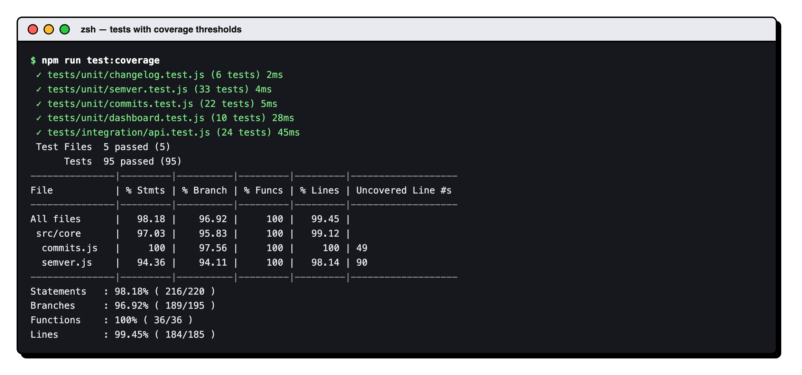

*Figure 4: All 95 unit and API tests pass, and coverage is well above the enforced thresholds (90% lines, statements and functions; 85% branches).*

### 6.3 Continuous integration on a pull request

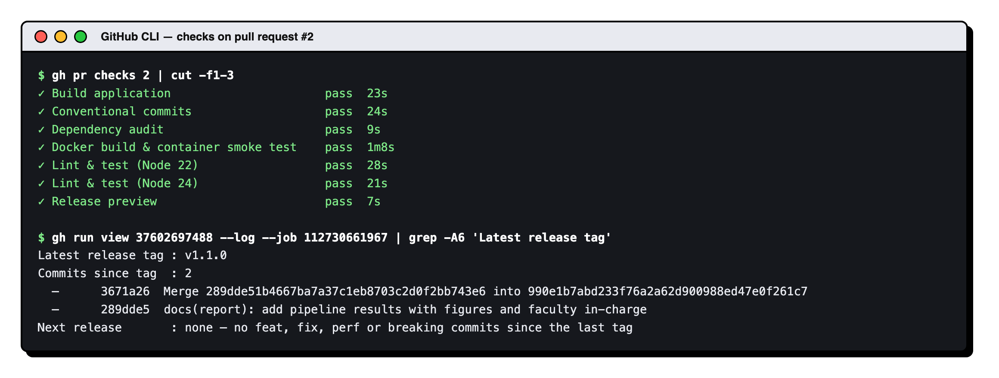

*Figure 5: The pull request that added this section. Every CI check passes, and the release preview correctly reports that a documentation-only change will not create a release.*

### 6.4 Automated release: v1.1.0

Pushing the commit `feat(ui): rebuild the dashboard in React with neobrutalism.dev components` to `main` produced release v1.1.0 with no manual steps.

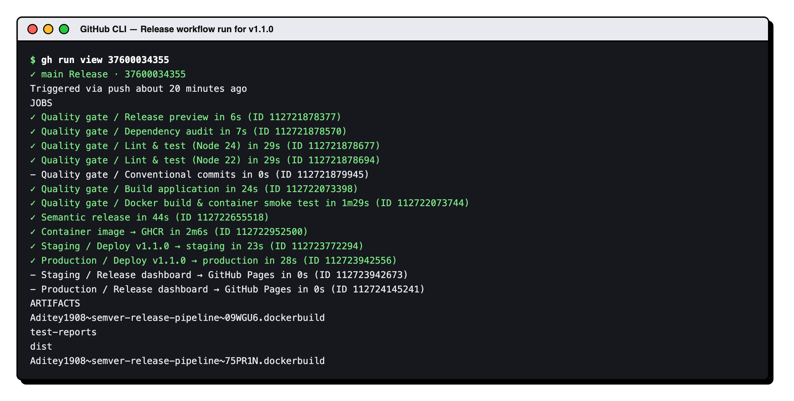

*Figure 6: The Release workflow. The quality gate, semantic release, image publication, staging and production all succeeded. The Conventional commits job only runs on pull requests, and the Pages jobs are switched off for this private repository.*

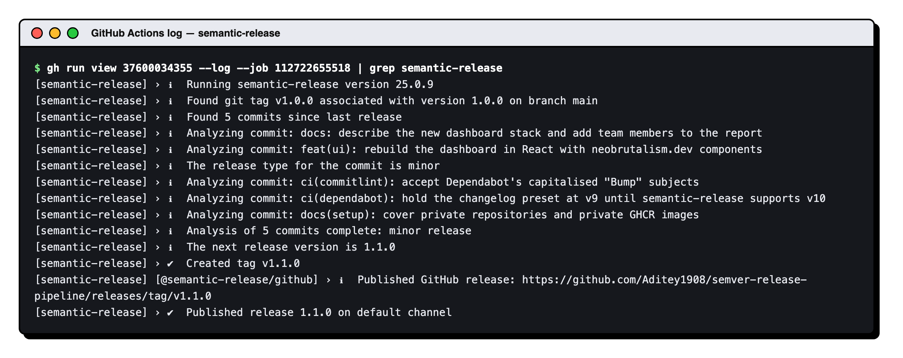

*Figure 7: semantic-release finds the previous tag (v1.0.0), analyses the five commits since it, identifies the `feat` commit as a minor change, and creates tag v1.1.0.*

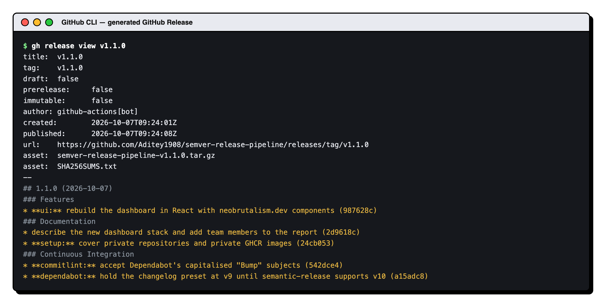

*Figure 8: The GitHub Release, with notes grouped by commit type and the versioned build artifact and checksum attached.*

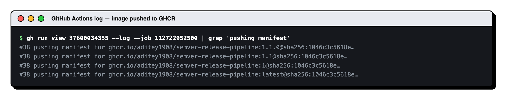

*Figure 9: One multi-architecture image, pushed to GHCR under the tags `1.1.0`, `1.1`, `1` and `latest`. All four tags point to the same digest.*

### 6.5 Deployment

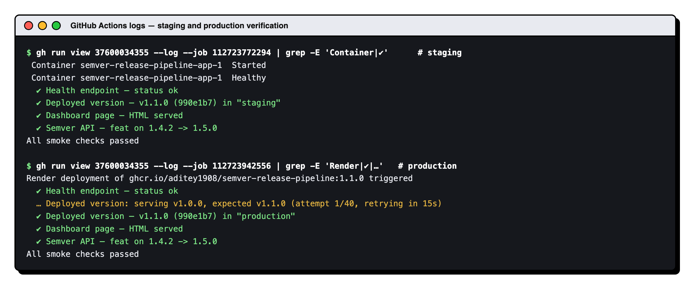

*Figure 10: Staging starts the released image with Docker Compose and waits until it is healthy. In production, the first check found Render still serving v1.0.0, so the smoke test waited and passed only once v1.1.0 was live.*

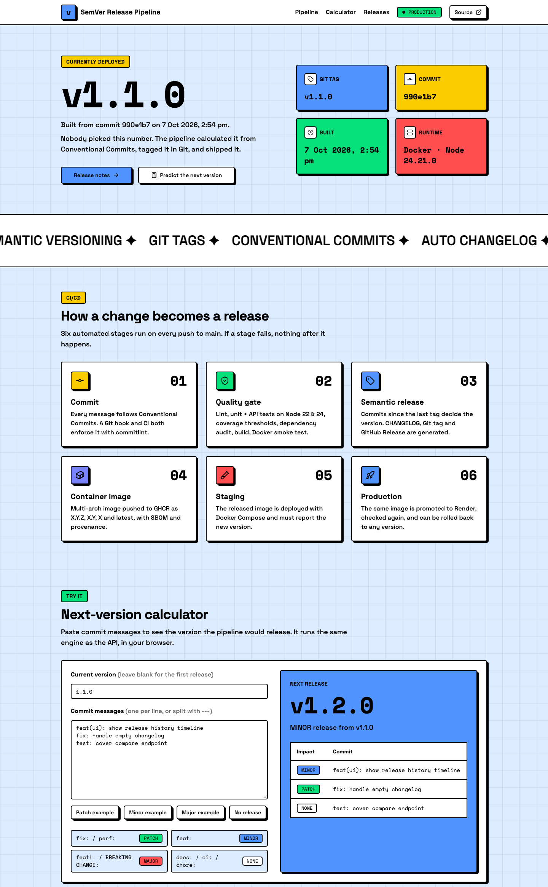

*Figure 11: The production deployment at https://devopslabca.onrender.com, showing the version, commit and build time stamped in by the pipeline.*

### 6.6 Rollback

On 21 October, release v1.1.1 (an upgrade of Express to 5.3.0) gave a second version with the current interface. Production was then rolled back to v1.1.0 and forward again.

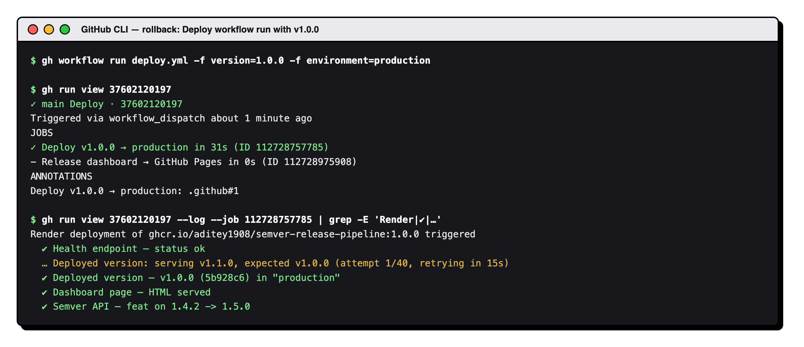

*Figure 12: A rollback is a manual run of the Deploy workflow with an earlier version. Production was serving v1.1.1, so the check waited until it served v1.1.0.*

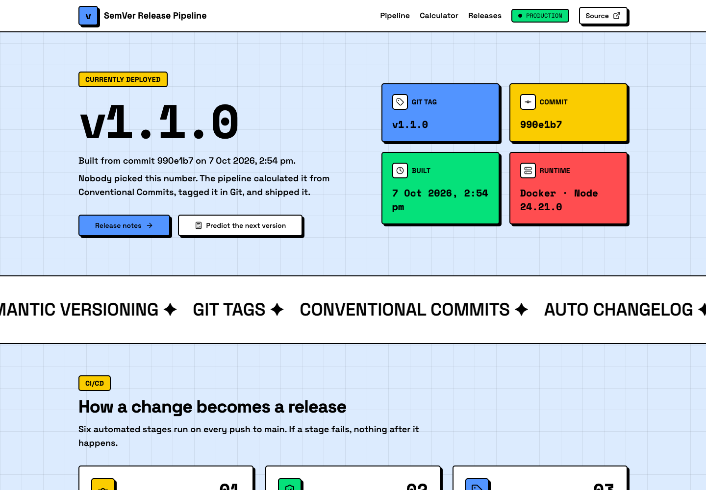

*Figure 13: Production after the rollback, running v1.1.0. The same workflow then rolled production forward to v1.1.1.*

The following were verified during development:

- All 95 tests pass, with about 99% line coverage.
- On 22 October, during a demo rehearsal, Aditya Baheti's commit `feat(api): add version parse endpoint` went through pull request #7, passed every check and reached production as **v1.2.0**, again with no manual steps.
- semantic-release was run against a test repository for four successive scenarios. A `fix` commit produced **1.0.1**, a `feat` produced **1.1.0**, a `ci`-only change produced **no release**, and a breaking change produced **2.0.0**. The app's own release preview predicted the same result in every case.
- The production container layout passed every smoke check, and the smoke test failed as expected when the deployed version did not match the expected one.

## 7. Mapping to the evaluation requirements

| Requirement (LAB CA, Activity 2) | Where it is implemented |
|---|---|
| Version control using Git/GitHub | Conventional Commits, Husky hooks, PR workflow, Git tags `vX.Y.Z`, GitHub Releases |
| Application build | Vite production bundle of the React dashboard plus stamped version metadata (`scripts/build.js` → `dist/`); release tarball and checksum |
| Automated testing | 95 Vitest unit and API tests, coverage thresholds, Node 22/24 matrix, post-deployment smoke tests |
| Containerisation using Docker | Multi-stage `Dockerfile`, hardened runtime, `HEALTHCHECK`, Compose manifest, multi-arch images in GHCR |
| CI/CD pipeline using GitHub Actions | `ci.yml`, `release.yml`, `deploy.yml` (reusable workflows, environments, concurrency) |
| Deployment to a suitable environment | Staging (Compose on the runner) → production (Render container, optional approval gate), with rollback |
| Project documentation | `README.md`, `docs/SETUP.md`, `docs/DEMO_GUIDE.md`, this report, generated `CHANGELOG.md` |

## 8. Challenges and solutions

| Challenge | Solution |
|---|---|
| Tags and releases pushed with `GITHUB_TOKEN` do not trigger other workflows, so a separate "on tag" workflow would never run | Image publishing and deployment are later jobs in the same workflow and receive the release version as job outputs |
| The release commit could start the pipeline again, in a loop | The release commit message contains `[skip ci]` |
| Git hooks installed by `npm ci` would run commitlint on the release commit inside CI | `HUSKY=0` disables hooks in all workflows, and commitlint ignores `chore(release)` commits |
| `docker/build-push-action` builds the *triggering* commit by default, which does not contain the bumped version | The image job checks out the new tag and builds with `context: .` |
| The newest changelog preset (`conventional-changelog-conventionalcommits@10`) failed at release time because it needs a newer changelog writer than semantic-release 25 ships. A dry run against a local test remote caught this. | Pinned the preset to the compatible major version (`^9`) and re-ran the full release simulation |
| The React build uses native binaries (Rolldown, Tailwind's engine, LightningCSS), and a lockfile created on macOS might not include the Linux and Alpine builds needed by CI and Docker | Checked that `package-lock.json` lists the Linux glibc and musl builds for x64 and arm64, and tested the Docker build stage with only the files it copies |
| A commit made in GitHub's web editor skipped the commit-message hook, so "Updated README.md" is in the history | A message with no type is ignored by the release tool, so it produced no wrong version. The team now commits locally and uses pull requests, where CI checks the message |
| A broken release must not reach users | The quality gate runs before any version is created, staging must pass before production, and the smoke test checks the exact deployed version |

## 9. Conclusion and future scope

The project turns releasing from a manual, error-prone procedure into a repeatable, auditable process. The version number is derived from what changed and is recorded as a Git tag. Every artifact, from the changelog and GitHub Release to the image tags and the running application, reports the same version. Each deployment is checked against it, and any earlier version can be restored with one action.

Possible extensions:

- Deploy to Kubernetes with Helm, versioning the chart in step with the application.
- Use canary or blue-green releases with automatic rollback on failing health metrics.
- Sign images with Sigstore cosign and verify the signatures before deployment.
- Add a Jenkins pipeline that runs the same stages, for comparison with GitHub Actions.
- Version packages independently in a monorepo.

## 10. References

1. T. Preston-Werner, *Semantic Versioning 2.0.0*. https://semver.org
2. *Conventional Commits 1.0.0*. https://www.conventionalcommits.org
3. semantic-release documentation. https://semantic-release.gitbook.io
4. GitHub Actions documentation: reusable workflows, environments and deployments. https://docs.github.com/actions
5. Docker documentation: multi-stage builds and Buildx. https://docs.docker.com
6. Render documentation: deploy hooks and deploying a prebuilt image. https://render.com/docs
7. commitlint documentation. https://commitlint.js.org
